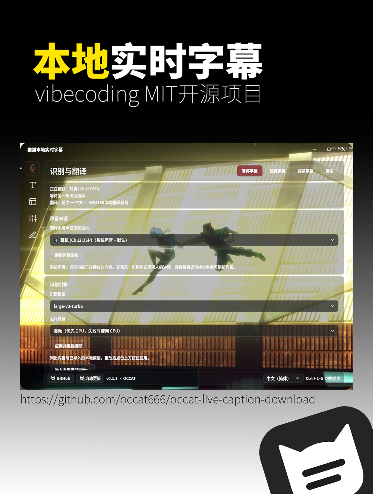

# Maomao Local Live Captions / 猫猫本地实时字幕

[简体中文](README.md) · [繁體中文](README.zh-TW.md) · **English** · [日本語](README.ja.md) · [한국어](README.ko.md) · By **OCCAT**

  

I'm **OCCAT**, and this is my local live caption tool for Windows, with a native macOS preview. It turns audio playing on your computer, or speech from your microphone, into floating captions. You can also translate between Chinese, English, Japanese and Korean, choosing Simplified or Traditional Chinese for Chinese output when you need it. You can use it while watching videos, taking courses, playing games, watching streams or joining personal meetings.

## 0.1.25 Update

- Live transcript gains an adjustable translucent window background so the video behind it remains visible. Window background opacity does not dim the text; original and translated caption backgrounds remain independently adjustable. History, always-on-top, scrollback and copying remain available. Recognition model behavior is unchanged.

This 0.1.25 build passed 922 tests across twenty-three groups, including 129 in-app update, 30 Japanese hallucination and 209 multilingual tests, retaining every previous group and at least 890 tests across twenty-two groups (23 independent-background, 8 Windows native-window, 5 flat-appearance, 26 panel-appearance and 5 caption-color tests). Five Windows installer languages, a real 0.1.24 to 0.1.25 upgrade and both native Mac builds passed verification. Frozen bilingual preview and translation routing passed on both platforms. The final Windows EXE used the existing M2M100 CPU model for 20 display directions: 18 cross-language inferences and 2 local Chinese script conversions, with target-cache isolation. This is not a translation accuracy or performance benchmark; the large-model matrix was not repeated on Mac. Physical audio and long-running use still need testing. Translucent transcript backgrounds passed 32 tests and 12 real subchecks on each frozen platform. Transcript appearance passed 28 tests and 12 real subchecks on each frozen platform. Output modes passed 20 tests. Both frozen platforms executed 12 floating-caption/live-transcript subchecks while retaining the 16 reading/history subchecks. Caption reading/history passed 101 tests covering dwell time, 500 original/translation entries, late translations and optional scrolling. The build passed 21 Windows and 19 Mac frozen checks. The final Windows EXE additionally checked three eight-second Japanese synthetic non-speech inputs with Turbo CPU and preserved the generated David English signoff using Base CPU and actual word alignment. The original user clip has not been reproduced. A real isolated Inno round trip also verified the final update helper acknowledging the live old frozen app, waiting for its exit, applying the signed installer and automatically restarting the new frozen app, with settings and model sentinels preserved. This uses an isolated install identity and offline restart-check arguments; it does not touch the user installation or certify every Windows environment.

## 0.1.24 Update

- Live transcript uses the same separate original and translation appearance settings as floating captions, including text and backgrounds. History, always-on-top and scrollback remain available. Remove the duplicate Caption settings button at the top of the main panel; use the left navigation. Recognition model behavior is unchanged.

This 0.1.24 build passed 890 tests across twenty-two groups, including 129 in-app update, 30 Japanese hallucination and 209 multilingual tests, retaining every previous group and at least 862 tests across twenty-one groups (23 independent-background, 8 Windows native-window, 5 flat-appearance, 26 panel-appearance and 5 caption-color tests). Five Windows installer languages, a real 0.1.23 to 0.1.24 upgrade and both native Mac builds passed verification. Frozen bilingual preview and translation routing passed on both platforms. The final Windows EXE used the existing M2M100 CPU model for 20 display directions: 18 cross-language inferences and 2 local Chinese script conversions, with target-cache isolation. This is not a translation accuracy or performance benchmark; the large-model matrix was not repeated on Mac. Physical audio and long-running use still need testing. Transcript appearance passed 28 tests and 12 real subchecks on each frozen platform. Output modes passed 20 tests. Both frozen platforms executed 12 floating-caption/live-transcript subchecks while retaining the 16 reading/history subchecks. Caption reading/history passed 101 tests covering dwell time, 500 original/translation entries, late translations and optional scrolling. The build passed 20 Windows and 18 Mac frozen checks. The final Windows EXE additionally checked three eight-second Japanese synthetic non-speech inputs with Turbo CPU and preserved the generated David English signoff using Base CPU and actual word alignment. The original user clip has not been reproduced. A real isolated Inno round trip also verified the final update helper acknowledging the live old frozen app, waiting for its exit, applying the signed installer and automatically restarting the new frozen app, with settings and model sentinels preserved. This uses an isolated install identity and offline restart-check arguments; it does not touch the user installation or certify every Windows environment.

## 0.1.23 Update

- Choose Floating captions or Live transcript using two large buttons in Caption settings. The live reader keeps each original and translation in order, supports always-on-top, scrollback and copying, and suits streams and films. Switching keeps history and continues recognition and translation.

This 0.1.23 build passed 862 tests across twenty-one groups, including 129 in-app update, 30 Japanese hallucination and 209 multilingual tests, retaining every previous group and at least 842 tests across twenty groups (23 independent-background, 8 Windows native-window, 5 flat-appearance, 26 panel-appearance and 5 caption-color tests). Five Windows installer languages, a real 0.1.22 to 0.1.23 upgrade and both native Mac builds passed verification. Frozen bilingual preview and translation routing passed on both platforms. The final Windows EXE used the existing M2M100 CPU model for 20 display directions: 18 cross-language inferences and 2 local Chinese script conversions, with target-cache isolation. This is not a translation accuracy or performance benchmark; the large-model matrix was not repeated on Mac. Physical audio and long-running use still need testing. Output modes passed 20 tests. Both frozen platforms executed 12 floating-caption/live-transcript subchecks while retaining the 16 reading/history subchecks. Caption reading/history passed 101 tests covering dwell time, 500 original/translation entries, late translations and optional scrolling. The build passed 19 Windows and 17 Mac frozen checks. The final Windows EXE additionally checked three eight-second Japanese synthetic non-speech inputs with Turbo CPU and preserved the generated David English signoff using Base CPU and actual word alignment. The original user clip has not been reproduced. A real isolated Inno round trip also verified the final update helper acknowledging the live old frozen app, waiting for its exit, applying the signed installer and automatically restarting the new frozen app, with settings and model sentinels preserved. This uses an isolated install identity and offline restart-check arguments; it does not touch the user installation or certify every Windows environment.

## 0.1.22 Update

- Unify caption reading time with an option to retain the latest caption when no new text arrives. Add a 500-entry original/translation history with copy and clear actions, plus optional scrolling captions. Independent original/translation styles remain available; recognition model logic is unchanged.

This 0.1.22 build passed 842 tests across twenty groups, including 129 in-app update, 30 Japanese hallucination and 209 multilingual tests, retaining every previous group and at least 741 tests across nineteen groups (23 independent-background, 8 Windows native-window, 5 flat-appearance, 26 panel-appearance and 5 caption-color tests). Five Windows installer languages, a real 0.1.21 to 0.1.22 upgrade and both native Mac builds passed verification. Frozen bilingual preview and translation routing passed on both platforms. The final Windows EXE used the existing M2M100 CPU model for 20 display directions: 18 cross-language inferences and 2 local Chinese script conversions, with target-cache isolation. This is not a translation accuracy or performance benchmark; the large-model matrix was not repeated on Mac. Physical audio and long-running use still need testing. Caption reading/history passed 101 tests covering dwell time, 500 original/translation entries, late translations and optional scrolling. The build passed 18 Windows and 16 Mac frozen checks. The final Windows EXE additionally checked three eight-second Japanese synthetic non-speech inputs with Turbo CPU and preserved the generated David English signoff using Base CPU and actual word alignment. The original user clip has not been reproduced. A real isolated Inno round trip also verified the final update helper acknowledging the live old frozen app, waiting for its exit, applying the signed installer and automatically restarting the new frozen app, with settings and model sentinels preserved. This uses an isolated install identity and offline restart-check arguments; it does not touch the user installation or certify every Windows environment.

## 0.1.21 Update

- Windows update offers show release information and the matching license terms. Explicit consent starts the installer download with progress; publisher-pinned RSA and SHA-256 checks precede replacement in the installed directory and restart, preserving settings and models. Mac retains manual DMG updates; 0.1.20 clients use their existing updater.

Version 0.1.20 and earlier use their existing flow to reach 0.1.21; after installing 0.1.21, future updates use the new consent, verification, installation and restart flow.

This 0.1.21 build passed 741 tests across nineteen groups, including 129 in-app update, 30 Japanese hallucination and 209 multilingual tests, retaining every previous group and at least 612 tests across eighteen groups (23 independent-background, 8 Windows native-window, 5 flat-appearance, 26 panel-appearance and 5 caption-color tests). Five Windows installer languages, a real 0.1.20 to 0.1.21 upgrade and both native Mac builds passed verification. Frozen bilingual preview and translation routing passed on both platforms. The final Windows EXE used the existing M2M100 CPU model for 20 display directions: 18 cross-language inferences and 2 local Chinese script conversions, with target-cache isolation. This is not a translation accuracy or performance benchmark; the large-model matrix was not repeated on Mac. Physical audio and long-running use still need testing. The build passed 17 Windows and 15 Mac frozen checks. The final Windows EXE additionally checked three eight-second Japanese synthetic non-speech inputs with Turbo CPU and preserved the generated David English signoff using Base CPU and actual word alignment. The original user clip has not been reproduced. A real isolated Inno round trip also verified the final update helper acknowledging the live old frozen app, waiting for its exit, applying the signed installer and automatically restarting the new frozen app, with settings and model sentinels preserved. This uses an isolated install identity and offline restart-check arguments; it does not touch the user installation or certify every Windows environment.

## 0.1.20 Update

- Improve review of suspected Japanese pause or low-confidence hallucinations, withdraw rejected captions and prevent late translations from restoring them, while preserving genuinely spoken signoffs. Independent caption styles, five translation targets and bilingual preview remain available.

This 0.1.20 build passed 612 tests across eighteen groups, including 30 Japanese hallucination and 209 multilingual tests, retaining every previous group and at least 543 tests across seventeen groups (23 independent-background, 8 Windows native-window, 5 flat-appearance, 26 panel-appearance and 5 caption-color tests). Five Windows installer languages, a real 0.1.19 to 0.1.20 upgrade and both native Mac builds passed verification. Frozen bilingual preview and translation routing passed on both platforms. The final Windows EXE used the existing M2M100 CPU model for 20 display directions: 18 cross-language inferences and 2 local Chinese script conversions, with target-cache isolation. This is not a translation accuracy or performance benchmark; the large-model matrix was not repeated on Mac. Physical audio and long-running use still need testing. The build passed 16 Windows and 15 Mac frozen checks. The final Windows EXE additionally checked three eight-second Japanese synthetic non-speech inputs with Turbo CPU and preserved the generated David English signoff using Base CPU and actual word alignment. The original user clip has not been reproduced.

## What's new in 0.1.19

- With translation enabled, caption preview shows both original and translated styles. Simplified and Traditional Chinese share the same recognizer. Select Simplified Chinese, Traditional Chinese, English, Japanese or Korean as the translation target; these languages can translate into one another. Chinese script conversion runs locally and identical source/target languages pass through. Existing compatible M2M100 models remain usable without another download.

This 0.1.19 build passed 543 tests across seventeen groups, including 209 multilingual tests, retaining every previous group and at least 334 tests across sixteen groups (23 independent-background, 8 Windows native-window, 5 flat-appearance, 26 panel-appearance and 5 caption-color tests). Five Windows installer languages, a real 0.1.18 to 0.1.19 upgrade and both native Mac builds passed verification. Frozen bilingual preview and translation routing passed on both platforms. The final Windows EXE used the existing M2M100 CPU model for 20 display directions: 18 cross-language inferences and 2 local Chinese script conversions, with target-cache isolation. This is not a translation accuracy or performance benchmark; the large-model matrix was not repeated on Mac. Physical audio and long-running use still need testing.

## What's new in 0.1.18

- Original and translated caption backgrounds can be enabled independently: both, original only, translation only or neither. Windows control-panel startup and closing use native system window paths and system animation settings. Mac receives the shared caption-background feature.

## What's new in 0.1.17

- Remove the fading dot decoration in the top-right corner. Night-mode cards, inputs and menus use #181818. Ordinary buttons in fixed night/day modes use solid flat colors without borders or translucent overlays. Full-background small dots, separate original/translation customization groups and custom themes are retained.

## What's new in 0.1.16

- Night mode uses #141414. Night and day modes add the small round pattern-dots-sm texture from pattern.css and remove card outlines. Caption appearance is organized into separate original and translated caption customization groups. Custom themes and saved caption styles are retained.

## What's new in 0.1.15

- Remove automatic dimming from interim captions and waiting hints, with 100% default text opacity for both original and translation.
- Manual text opacity, colors, outlines, shadows and separate original/translation styles remain adjustable; saved manual settings are retained.

## What's new in 0.1.14

- Keep the subtitle background size and position stable when toggling or adjusting text outlines and shadows.
- Retain separate original/translation styles, two-sentence context and live response behavior. See the release notes for behavior and validation scope.

## What's new in 0.1.13

- Keep about two recent sentences, fitted to each role's font and screen width. Update the original immediately instead of replaying old pages.
- A delayed translation can fill the retained previous record without moving the current original back. Replacements preserve reading time to reduce flashes. See the release notes for scope and limitations.

## What's new in 0.1.12

- Reduce waiting in live caption processing and presentation while retaining readable chunks, independent original/translation tracks and complete received-text logs.
- Performance still depends on the model and hardware; zero latency, word-level timing alignment and recovery of audio skipped by backpressure are not promised.

## What you can do

- System-audio and microphone input, with model-dependent Chinese, English, Japanese, Korean and automatic recognition, displayed as floating captions.
- Optional real-time translation with original text; recognition engines, translation and model management share the Recognition and translation page.
- Short model descriptions and recommendations, official and mirror links, one-click downloads, resumable transfers, verification and local model import.
- Caption fonts, weights, size, color, outlines, shadows, placement and backdrop controls, with saved appearance versions. Caption glyphs have five choices: Simplified Chinese, Traditional Chinese, Japanese glyphs, Korean glyphs, or the original text. These glyph settings affect the original text only and do not change the independent translation target. Japanese and Korean originals use the bundled regional Source Han fonts.
- Five interface and installer languages: 中文（简体）, 中文（繁体）, English, 日本語 and 한국어. Interface language, caption glyphs and recognition language are saved separately.
- HarmonyOS Sans, MiSans, Source Han Sans and Source Han Serif interface fonts with their original weight choices, plus local TTF, OTF and TTC font import.
- Dark, day, system and custom themes. Custom backgrounds share glass opacity, blur and dimming controls; idle navigation icons follow text color and pressed or selected icons use the accent.
- Five Feather vector icon entries with floating names and one moving indicator, Tab navigation, Ctrl+1–5 page shortcuts and optional interface motion.
- Pause, preview, hide, click-through, standby, tray access, in-app public-release update checks including previews, mouse-wheel scrolling and direct touchpad input.

Changes and fixes belong in the [0.1.25 release notes](https://github.com/occat666/occat-live-caption-download/releases/tag/v0.1.25).

## What's new in 0.1.11

- Break long captions at punctuation and readable length limits, then show shorter pieces at a reading pace.
- Originals and translations advance independently and retain their separate styles. These are two text tracks, without word-level or sentence-level timing alignment guarantees.
- A new recognition segment replaces the old segment instead of building a display backlog. Clearing, pausing, previewing and session changes discard the old presentation. Hiding captions keeps recognition running; showing them again reveals the current reading position.
- Local transcript logs retain complete received recognition and translation results; short on-screen pieces do not rewrite those results.

## What's new in 0.1.10 (previous release)

- Fix phase-opposed stereo cancelling out during downmixing and centre-only speech being excessively attenuated in multichannel input. Sustained quiet speech has a lower onset threshold, with short-pulse and background-noise protection retained.
- Input and output enumeration failures are handled separately. A retired device is recovered by name and source type; ambiguous matches ask for reselection instead of silently capturing a same-named microphone.
- While busy, keep only the newest waiting final and interim utterance; replaced audio is skipped to catch up with playback. For complete transcripts, choose a model that keeps up with real time. The console distinguishes missing device data, received sound and recognition in progress.
- Use recognition confidence and no-speech probability when filtering low-confidence repetition or boilerplate, reducing hallucinated captions from silence or background sound while retaining normal speech supported by sufficient recognition evidence.
- Independent original/translation styles, CJK glyph choices, five interface languages and first-use large-v3-turbo downloads remain available. Speed and accuracy still depend on the model, content and hardware; zero delay and zero hallucinations are not guaranteed.

- Remove generic Chinese/English context prompts, fixing a reproduced case in which a harmonic tone was transcribed as the prompt itself; actual-model fixtures verify this case.

## What's new in 0.1.9 (previous release)

- Style recognized originals and translated captions separately: font, size, weight, color, opacity, outline and shadow.
- Open Caption appearance for the original and translation controls. Preview the translation style even with translation off. Position, background, line spacing and maximum lines remain shared.
- Existing settings seed the translation style once; subsequent changes are saved independently. Five interface languages, live translation, CJK glyph options and first-use large-v3-turbo downloads remain available.

## What's new in 0.1.6 (previous release)

- In-app update checks find the newest public version, including previews, instead of relying only on GitHub's stable latest-release endpoint. After downloading and confirmation, installed copies upgrade in their current installation directory and retain settings, models and language choices.
- Portable copies explain the update path before opening the ordinary installation wizard; the original portable folder is not silently overwritten. **Version 0.1.5 and earlier must first install 0.1.6 or later manually from Releases; subsequent updates can use the new in-app updater.**
- A caption's auto-hide timer starts after its current translation completes. Partial-result translation is throttled and prioritizes the current utterance, reducing premature hiding and stale translations replacing a newer sentence. Pause, switching, clearing and retired jobs keep separate state.
- If the GitHub API is rate-limited or unavailable, update checks fall back to the project's official public update manifest. Installer downloads still require exact size and SHA-256 verification.

## Download and install

**[Open the 0.1.25 public preview](https://github.com/occat666/occat-live-caption-download/releases/tag/v0.1.25)**. This is a **prerelease**. [The previous 0.1.24](https://github.com/occat666/occat-live-caption-download/releases/tag/v0.1.24) remains available for rollback; other earlier releases are also retained.

Choose **either the installer or the portable archive**. You do not need the entire repository or every ZIP:

| File | Purpose |
| --- | --- |
| [OCCAT-Live-Caption-0.1.25-windows-x64-setup.exe](https://github.com/occat666/occat-live-caption-download/releases/download/v0.1.25/OCCAT-Live-Caption-0.1.25-windows-x64-setup.exe) | One installer with 简体中文 / 繁體中文 / English / 日本語 / 한국어 |
| [OCCAT-Live-Caption-0.1.25-windows-x64-portable.zip](https://github.com/occat666/occat-live-caption-download/releases/download/v0.1.25/OCCAT-Live-Caption-0.1.25-windows-x64-portable.zip) | Extract the complete archive and run `OCCATLiveCaption.exe` |
| [SHA256SUMS.txt](https://github.com/occat666/occat-live-caption-download/releases/download/v0.1.25/SHA256SUMS.txt) | Optional checksums for this version’s Windows assets |
| Corresponding-source and Third-Party-Notices ZIPs | Library sources and license materials; not required for ordinary use |

1. Use **Windows 10/11 x64** with Microsoft Visual C++ x64 Runtime **14.44.35211 or newer**. If it is missing or outdated, setup asks before downloading it directly from Microsoft, verifies Microsoft's signature and opens the runtime installer. Confirm the Microsoft license and Windows administrator prompt; caption setup continues after a successful runtime check. This download needs internet access. Setup never restarts Windows automatically: save your work, restart and rerun setup if Microsoft requires a restart. The portable version also needs this runtime.
2. Run the installer and choose Simplified Chinese, Traditional Chinese, English, Japanese or Korean, or fully extract the portable ZIP before starting it. Do not copy out the EXE alone. The installer has no commercial code-signing certificate; verify the download source and SHA-256.
3. Select the actual system output device or microphone. New users default to **Whisper large-v3-turbo**: first use needs internet access to download about **1.6 GB** and verify its files. Downloads support resume and source fallback. Complete cached models are loaded locally and can run offline. Download the other 8 recognition models on demand or import compatible local files; upgrades preserve saved model choices.
4. For translation, download or import a compatible **M2M100** model from Recognition and translation, then enable real-time translation. Leave it off for original captions only.
5. Adjust caption styling in Caption appearance and positioning, click-through and standby options in Window and standby. The footer language menu supports 中文（简体）, 中文（繁体）, English, 日本語 and 한국어; recognition language is a separate setting. Choose Chinese/Japanese/Korean caption glyphs under Caption appearance → Caption customization → Text; changing interface language does not change them.

The software version is **0.1.25**, with release tag **`v0.1.25`**. It remains a prerelease. **This version supports public preview updates in the app. Version 0.1.5 and earlier still query only the old latest endpoint and need one manual installation of 0.1.6 or later; later checks and updates can then run in the app.** Users of the older separate-language installers can upgrade manually with the unified installer above. Traditional Chinese, Japanese and Korean setup retain the reviewed original English component terms.

Installation is per user and preserves existing preferences. Both versions store settings, downloaded models and caption records under `%LOCALAPPDATA%/OCCATLiveCaption`; uninstall retains that data. The portable version does not store preferences alongside the extracted EXE.

**Upgrading from an older version:** Saved model choices and other settings are preserved. If Base is still selected, open Speech + translation → Recognition engine → Recognition model, choose `large-v3-turbo`, then click Apply and reload model to download and use Turbo. New users default to Turbo.

## macOS preview downloads

**Requires macOS 14 or newer.** Choose one DMG for your processor:

| Mac processor | Download |
| --- | --- |
| Apple silicon (M1 and later) | [OCCATLiveCaption-0.1.25-macOS-arm64.dmg](https://github.com/occat666/occat-live-caption-download/releases/download/v0.1.25/OCCATLiveCaption-0.1.25-macOS-arm64.dmg) |
| Intel | [OCCATLiveCaption-0.1.25-macOS-x86_64.dmg](https://github.com/occat666/occat-live-caption-download/releases/download/v0.1.25/OCCATLiveCaption-0.1.25-macOS-x86_64.dmg) |

Open the DMG and drag the app to Applications. This preview is **ad-hoc signed and is not Apple-notarized**. After your first attempt to open it, macOS may require Open Anyway for this app in System Settings → Privacy & Security. Verify the Mac assets with [SHA256SUMS-macOS.txt](https://github.com/occat666/occat-live-caption-download/releases/download/v0.1.25/SHA256SUMS-macOS.txt) from the same Release. The Mac update entry opens the Releases download page; download a new DMG and replace the app. Settings, models and caption records reside in `~/Library/Application Support/OCCATLiveCaption`.

The Mac preview uses **CPU inference**. New users still download **large-v3-turbo (about 1.6 GB)** on first use; no model is bundled and the app does not automatically switch to Base. Other models remain optional downloads. CPU speed for large models depends on hardware; real-time performance is not guaranteed.

Audio comes from CoreAudio inputs and microphone permission is required when capture starts. Capturing playback audio requires **BlackHole or another virtual input installed and configured by you**; the app includes and installs no audio driver. See [macOS audio setup (Chinese)](docs/macos-audio.md).

The Mac preview bundles Source Han Sans, Source Han Serif, and the Japanese/Korean regional Source Han Sans fonts; additional fonts can be imported locally.

## Custom theme example

This user-provided screenshot previews a custom theme. Select Custom in Page appearance to choose your own background image; the original wallpaper is not distributed with the installer.

## Validation and use

**It has not been tested on a clean Windows system without the runtime and remains a prerelease.** I do not treat these checks as certification for every GPU, monitor, audio device or Windows configuration.

Recognition and translation run locally. First-use recognition model downloads, on-demand translation model downloads and update checks use the network. Complete cached models can run locally offline. **Caption text is saved locally by default**; disable logging in Advanced settings if preferred. Disabling it does not remove previous records. Personal backgrounds and user-imported models or fonts are not bundled with official downloads.

Captions and translations can be wrong; verify important content yourself. This is a reading aid, not a substitute for professional accessibility services or formal records. Process content you are entitled to use and obtain permission before capturing other people's speech.

## Licenses and publication scope

My own code and these download-repository documents use [MIT](LICENSE), copyright **OCCAT**. **The application development source repository remains Private. This public repository provides downloads and distribution materials; it does not claim that all application source has been published.**

The complete package is not MIT-only. Navigation and window controls use [official Feather v4.29.0 icons](https://github.com/feathericons/feather/tree/v4.29.0); the [original MIT license](https://github.com/feathericons/feather/blob/v4.29.0/LICENSE) is included in the installer and same-version notice archive. Fonts, on-demand Whisper models, Qt, FFmpeg/PyAV, Sherpa ASR and vendor components retain their respective licenses and terms. Original font licenses are included in the same-version notice archive. The added Japanese and Korean regional Source Han Sans fonts are original Adobe files under SIL Open Font License 1.1; their original licenses accompany the same-version materials.

Same-version releases provide third-party corresponding sources, build resources, original copyright notices and checksums. See [third-party notices](THIRD_PARTY_NOTICE_PUBLIC.md) and the [library modification/replacement guide](LIBRARY_REPLACEMENT.en.md). Applicable rights to modify, replace and debug LGPL libraries remain intact. Public assets exclude the application's own Source.zip, build reports and user data.

Please report issues in [Issues](https://github.com/occat666/occat-live-caption-download/issues), including the candidate version, system, model and reproduction steps. Remove private paths, account details, recordings and real conversations before submitting evidence.

[0.1.19](https://github.com/occat666/occat-live-caption-download/releases/tag/v0.1.19)
