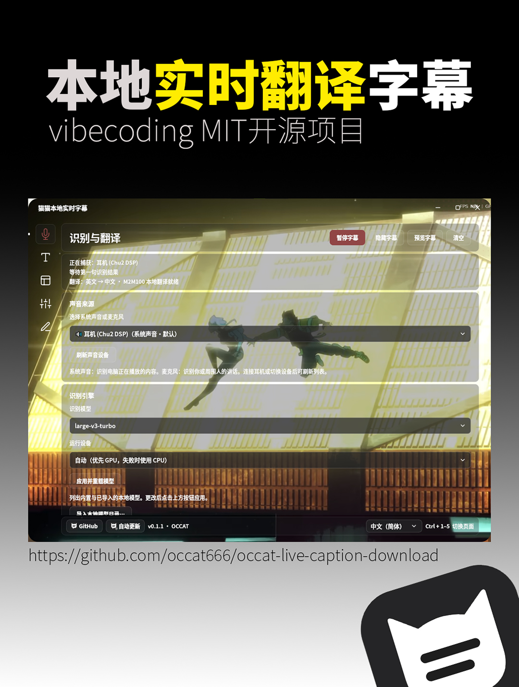

# 마오마오 로컬 실시간 자막 / Maomao Local Live Captions

[简体中文](README.md) · [繁體中文](README.zh-TW.md) · [English](README.en.md) · [日本語](README.ja.md) · **한국어** · 작성자 **OCCAT**

  

안녕하세요, **OCCAT**입니다. 제가 만든 Windows용 로컬 실시간 자막 도구를 소개합니다. 컴퓨터에서 재생되는 소리나 마이크로 입력한 음성을 화면 위에 떠 있는 자막으로 표시합니다. 필요할 때는 영어, 일본어, 한국어를 중국어로 번역할 수도 있습니다. 동영상 시청, 강의 수강, 게임, 라이브 방송 시청, 개인적으로 참여하는 회의 등에서 내용을 읽고 이해하는 데 활용할 수 있습니다.

## 주요 기능

- 시스템 오디오와 마이크 입력을 지원합니다. 인식 모델의 지원 범위에 따라 중국어, 영어, 일본어, 한국어 또는 자동 감지를 선택하고, 결과를 플로팅 자막으로 표시할 수 있습니다.
- 실시간 번역을 별도로 켜고 끌 수 있으며 원문도 함께 표시할 수 있습니다. 인식 엔진, 번역, 모델 관리는 “识别与翻译”(인식 및 번역) 페이지에 모았습니다.
- 모델 설명과 추천 안내, 공식·미러 다운로드 경로, 원클릭 다운로드, 이어받기, 파일 검증, 로컬 모델 가져오기를 제공합니다.
- 자막 글꼴, 굵기, 크기, 색상, 외곽선, 그림자, 위치와 배경을 조절할 수 있습니다. 모양 설정을 저장했다가 필요할 때 복원할 수도 있습니다. 중국어 자막은 간체, 번체 또는 원문 유지 중에서 선택하며, 중국어 원문과 중국어 번역문에 함께 적용됩니다.
- 화면과 설치 프로그램은 简体中文, 繁體中文, English, 日本語, 한국어의 다섯 가지 언어를 지원합니다. 화면 언어, 중국어 자막의 간체·번체 설정, 음성 인식 언어는 각각 따로 저장합니다.
- 화면 글꼴로 HarmonyOS Sans, MiSans, Source Han Sans(思源黑体), Source Han Serif(思源宋体)를 제공하며, 각 글꼴에서 원래 제공하는 굵기를 선택할 수 있습니다. 로컬 TTF, OTF, TTC 글꼴 가져오기도 지원합니다.
- 어두운 테마, 밝은 테마, 시스템 설정 따르기, 사용자 지정 테마를 제공합니다. 사용자 지정 배경에는 유리 효과의 투명도, 흐림, 어둡게 하기 설정이 함께 적용됩니다. 기본 상태의 탐색 아이콘은 글자 색상을 따르고, 누르거나 선택한 아이콘은 테마 강조 색상을 사용합니다.
- 다섯 개의 Feather 벡터 탐색 아이콘, 이름 툴팁, 하나의 움직이는 선택 표시를 제공합니다. Tab 키 탐색, Ctrl+1～5 페이지 전환, 화면 애니메이션 끄기를 지원합니다.
- 일시 정지, 미리 보기, 자막 숨기기, 마우스 클릭 통과, 대기 모드, 트레이 메뉴, 정식 버전 업데이트 확인 기능이 있습니다. 설정 페이지는 마우스 휠과 터치패드 스크롤을 지원합니다.

이번 변경 및 수정 사항은 [0.1.5 릴리스 노트](https://github.com/occat666/occat-live-caption-download/releases/tag/v0.1.5)에서 확인할 수 있습니다.

## 0.1.5 변경 사항

- 인식 모델의 첫 다운로드, 로드 및 준비 실행 단계를 자막 창에도 표시합니다. 모델이 준비되기 전에 “오디오 입력 대기 중”을 미리 표시하지 않습니다.
- 모델 로드에 실패하면 해당 오류를 표시합니다. 모델이 준비되면 선택한 오디오 입력에 자동으로 연결한 후 대기 상태로 전환합니다. 초기화를 계속하기 위해 앱을 다시 실행할 필요가 없습니다.
- 완전한 모델 캐시는 계속 로컬에서 우선 로드하므로 다시 다운로드하지 않습니다. 첫 다운로드 완료 안내도 자동으로 로드가 이어짐을 알리도록 바꿨습니다. 테마 색 설정은 사용자 지정 모드에서만 표시합니다.

## 다운로드 및 설치

**[0.1.5 공개 테스트 버전 열기](https://github.com/occat666/occat-live-caption-download/releases/tag/v0.1.5)**. 이 버전은 **prerelease(사전 공개 버전)**입니다. 이전 버전으로 돌아갈 수 있도록 [이전 0.1.1](https://github.com/occat666/occat-live-caption-download/releases/tag/v0.1.1)를 유지하고 있으며, 그 밖의 과거 버전도 Releases에 남아 있습니다.

설치형과 무설치형 중 **하나만 선택하면 됩니다**. 저장소 전체나 모든 ZIP 파일을 다운로드할 필요는 없습니다.

| 파일 | 용도 |
| --- | --- |
| [OCCAT-Live-Caption-0.1.5-windows-x64-setup.exe](https://github.com/occat666/occat-live-caption-download/releases/download/v0.1.5/OCCAT-Live-Caption-0.1.5-windows-x64-setup.exe) | 简体中文 / 繁體中文 / English / 日本語 / 한국어를 모두 제공하는 설치 프로그램 |
| [OCCAT-Live-Caption-0.1.5-windows-x64-portable.zip](https://github.com/occat666/occat-live-caption-download/releases/download/v0.1.5/OCCAT-Live-Caption-0.1.5-windows-x64-portable.zip) | 무설치형. 압축을 완전히 푼 다음 `OCCATLiveCaption.exe` 실행 |
| [SHA256SUMS.txt](https://github.com/occat666/occat-live-caption-download/releases/download/v0.1.5/SHA256SUMS.txt) | 선택 사항. 같은 버전의 공개 첨부 파일을 검증할 때 사용 |
| `CorrespondingSources-*.zip`, `Sources-Sherpa-ASR-*.zip`, `OCCAT-Live-Caption-0.1.5-Third-Party-Notices.zip` | 제삼자 구성 요소의 대응 소스 코드와 라이선스 자료. 일반적인 실행에는 개별 다운로드 불필요 |

1. **Windows 10/11 x64**와 **14.44.35211 이상**의 Microsoft Visual C++ x64 런타임이 필요합니다. 런타임이 없거나 너무 오래된 경우, 설치 프로그램은 사용자 확인을 받은 뒤 Microsoft 공식 경로에서 다운로드하고 서명을 검증한 다음 런타임 설치 화면을 엽니다. 안내에 따라 Microsoft 라이선스와 관리자 권한 요청을 확인하면, 런타임 설치 후 자막 프로그램 설치가 자동으로 계속됩니다. 인터넷 연결이 필요하며 Windows를 자동으로 다시 시작하지 않습니다. Microsoft 설치 프로그램에서 다시 시작을 요구하면 작업을 저장하고 직접 다시 시작한 후 자막 설치 프로그램을 다시 실행하세요. 무설치형도 이 런타임을 먼저 갖추어야 합니다.
2. 설치형은 EXE를 두 번 클릭한 뒤 중국어 간체, 중국어 번체, 영어, 일본어, 한국어 중 하나를 선택하고 안내에 따라 설치하세요. 무설치형은 압축을 완전히 푼 후 실행해야 하며, EXE 파일만 따로 꺼내 실행하면 안 됩니다. 설치 프로그램에는 상용 코드 서명이 없으므로 다운로드 출처와 SHA-256을 확인하세요.
3. “猫猫本地实时字幕”를 실행하고 실제 소리를 재생하는 시스템 장치나 마이크를 선택하세요. 새 사용자의 기본 모델은 **Whisper large-v3-turbo**이며, 처음 사용할 때 인터넷에 연결하여 약 **1.6 GB**를 다운로드하고 파일을 검증해야 합니다. 이어받기와 다운로드 경로 전환을 지원합니다. 완성된 캐시는 로컬에서 우선 불러오며 오프라인으로 사용할 수 있습니다. 나머지 8개 인식 모델은 필요할 때 다운로드하거나 호환되는 로컬 모델을 가져오세요. 업데이트는 저장된 모델 선택을 덮어쓰지 않습니다.
4. 번역이 필요하면 “识别与翻译”(인식 및 번역)에서 호환되는 **M2M100** 모델을 다운로드하거나 가져온 다음 “实时翻译”(실시간 번역)를 켜세요. 원문만 보려면 꺼 둡니다.
5. “字幕外观”(자막 모양)에서 자막 스타일을, “窗口与待机”(창 및 대기)에서 위치, 마우스 클릭 통과, 대기 방식을 조절하세요. 하단 언어 메뉴는 简体中文, 繁體中文, English, 日本語, 한국어를 지원하며, 인식 언어는 별도로 설정합니다. 중국어 자막의 간체·번체는 “字幕外观 → 文字”(자막 모양 → 텍스트)에서 설정하며, 화면 언어를 바꾸어도 함께 바뀌지 않습니다.

이번 소프트웨어 버전은 **0.1.5**, 릴리스 태그는 **`v0.1.5`**이며, 여전히 사전 공개 버전으로 제공합니다. **테스트 버전은 GitHub의 latest 정식 릴리스 API를 통한 업데이트 대상으로 제공되지 않습니다. Releases에서 직접 다운로드하세요.** 예전의 언어별 설치 프로그램을 사용 중이라면 위의 통합 설치 프로그램으로 수동 업데이트할 수 있습니다. 중국어 번체, 일본어, 한국어 설치 마법사에는 검토를 마친 구성 요소 약관의 영어 원문을 그대로 제공합니다.

사용자별로 설치하며 기존 설정을 우선 유지합니다. 설치형과 무설치형 모두 설정, 다운로드한 모델, 자막 기록을 `%LOCALAPPDATA%/OCCATLiveCaption`에 저장하며, 제거 후에도 사용자 데이터는 남습니다. 무설치형도 압축을 푼 폴더에 설정을 저장하지 않습니다.

**이전 버전에서 업데이트하는 경우:** 저장된 모델 선택과 다른 설정을 유지합니다. 업데이트 후에도 Base가 선택되어 있으면 인식 및 번역 → 인식 엔진 → 인식 모델에서 `large-v3-turbo`를 선택한 다음 ‘적용 후 모델 다시 로드’를 눌러 Turbo를 다운로드하고 사용하세요. 새 사용자의 기본 모델은 Turbo입니다.

## 사용자 지정 테마 예시

사용자가 제공한 사용자 지정 테마의 스크린샷입니다. “页面外观”(화면 모양)에서 “自定义”(사용자 지정)를 선택하면 원하는 배경 이미지를 설정할 수 있습니다. 원본 배경화면은 설치 패키지에 포함하지 않습니다.

## 검증 범위 및 사용 안내

이번에는 첫 실행 상태, 로드 실패, 모델 준비 후 오디오 자동 연결, 일시 중지와 다시 로드, 이전 이벤트 제외를 중점적으로 검증합니다.

**관련 단위 검사 155개**, 동결 앱의 시작 상태 검사, 다섯 설치 언어 모두의 격리 설치, 오프라인 화면 실행 및 제거 검사를 통과했습니다. 소스 실행 앱과 동결 앱 모두 **로컬에 완전히 캐시된 Turbo 모델로 CPU에서 음성 테스트 자료를 실제로 인식**했으며, 인식 하위 프로세스의 종료도 확인했습니다. 모델을 새로 다운로드하는 테스트는 아니었습니다. 이번에는 전체 가중치를 다시 다운로드하거나 현장의 실제 음성을 수집하지 않았으며, 제보자의 하드웨어나 런타임이 없는 깨끗한 Windows 환경에서도 검증하지 않았습니다. 모든 장치와 네트워크 구성을 인증하는 결과는 아닙니다. Windows 파일 버전 **0.1.5.0**은 빌드 보고서의 동결 앱 검사 결과에서 확인했습니다.

**런타임이 없는 깨끗한 Windows 환경에서는 아직 실제로 테스트하지 않았으며, 여전히 사전 공개 버전입니다.** 이러한 확인을 모든 GPU, 다중 모니터, 오디오 장치, 시스템 조합에 대한 보장으로 여기지는 않습니다.

인식과 번역은 사용자 컴퓨터에서 실행합니다. 첫 인식 모델 다운로드, 필요에 따른 번역 모델 다운로드 및 업데이트 확인에는 네트워크를 사용합니다. 모델 캐시가 완성되면 로컬에서 오프라인으로 사용할 수 있습니다. **자막 텍스트는 기본적으로 로컬에 저장합니다.** 고급 설정에서 저장을 끌 수 있으며, 꺼도 이전 기록은 삭제되지 않습니다. 개인 배경 이미지, 직접 가져온 모델과 글꼴은 공식 설치 패키지에 포함하지 않습니다.

자막과 번역에는 오류가 있을 수 있으므로 중요한 내용은 직접 확인하세요. 이 도구는 읽기를 돕기 위한 것으로, 전문적인 접근성 서비스나 공식 기록을 대신하지 않습니다. 사용 권한이 있는 내용만 처리하고, 다른 사람의 발언을 수집하기 전에 필요한 동의를 받으세요.

## 라이선스 및 공개 범위

이 다운로드 저장소의 문서와 제가 직접 작성한 코드는 **OCCAT**을 저작자로 하는 [MIT](LICENSE) 라이선스를 따릅니다. **애플리케이션 개발 소스 저장소는 Private 상태를 유지합니다. 이 공개 저장소는 프로그램 다운로드와 배포 자료를 제공하며, 애플리케이션 소스 전체가 공개되었다는 뜻은 아닙니다.**

설치 패키지 전체가 MIT 라이선스인 것은 아닙니다. 탐색 메뉴와 창 컨트롤에는 [Feather v4.29.0 공식 아이콘](https://github.com/feathericons/feather/tree/v4.29.0)을 사용하며, [MIT 라이선스 원문](https://github.com/feathericons/feather/blob/v4.29.0/LICENSE)을 설치 패키지와 같은 버전의 고지 자료 압축 파일에 포함합니다. 네 가지 화면 글꼴, 필요할 때 다운로드하는 Whisper 모델, Qt, FFmpeg/PyAV, Sherpa ASR, Intel/NVIDIA 등의 구성 요소에는 각각 해당하는 라이선스와 구성 요소 약관이 적용됩니다. 글꼴의 라이선스 원문도 이번 버전의 고지 자료 압축 파일에 포함합니다.

같은 버전의 Release에는 제삼자 구성 요소의 대응 소스 코드, 빌드 자료, 저작권 고지 원문, 체크섬 목록을 첨부합니다. [제삼자 라이선스 안내](THIRD_PARTY_NOTICE_PUBLIC.md)와 [공유 라이브러리 수정·교체 안내](LIBRARY_REPLACEMENT.en.md)를 확인하세요. 적용되는 LGPL의 수정, 교체 및 필요한 디버깅 권리는 그대로 유지됩니다. 공개 첨부 파일에는 자체 애플리케이션의 Source.zip, 빌드 보고서, 사용자 데이터를 포함하지 않습니다.

[Issues](https://github.com/occat666/occat-live-caption-download/issues)에 의견이나 문제를 알려 주세요. 테스트한 버전, 시스템, 모델, 재현 절차를 함께 적고, 제출하기 전에 개인 폴더 경로, 계정 정보, 녹음, 실제 대화 내용을 삭제해 주세요.
