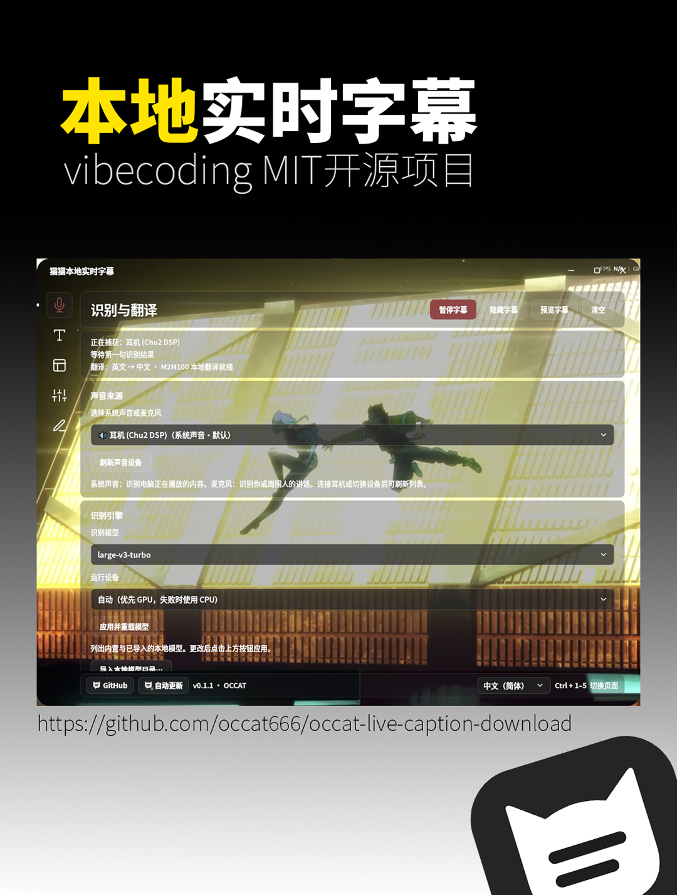

# 猫猫本地实时字幕 / Maomao Local Live Captions

**简体中文** · [繁體中文](README.zh-TW.md) · [English](README.en.md) · [日本語](README.ja.md) · [한국어](README.ko.md) · 作者 **OCCAT**

  

我是 **OCCAT**，这是我做的本地实时字幕工具，提供 Windows 版和 macOS 原生预览版。你可以把电脑正在播放的声音，或者麦克风里的说话声，显示成悬浮字幕；需要的时候，也可以在中文（简体）、中文（繁体）、英语、日语、韩语之间选择翻译目标。看视频、听课、玩游戏、看直播，或者开个人会议时，都可以用它辅助阅读。

## 0.1.25 更新

- 实时记录窗口增加可调节的半透明背景，观看直播、电影时可透出后面的画面；调整窗口背景不改变文字自身透明度，原文与译文各自的背景设置继续独立。保留逐句历史、置顶、回看和复制。识别模型逻辑不变。

0.1.25本轮二十三组共922项回归通过，其中软件内更新专项129项、日文幻觉专项30项、多语言209项，并逐组保留上版二十二组至少890项覆盖（独立背景23、Windows原生窗口8、平面外观5、页面外观26、字幕颜色5项）。Windows五语安装/启动/卸载、0.1.24→0.1.25覆盖升级和Mac两架构核验通过。双语预览/翻译路由在两平台冻结程序中通过；Windows最终EXE用现有M2M100 CPU模型验证20个显示方向（18次跨语言推理、2次中文简繁本地转换）与目标缓存隔离。此翻译夹具不代表一般准确率或性能；Mac未重复运行该大模型矩阵。实体音频与长期使用仍须实测。 实时记录透明背景专项32项通过，两平台冻结程序各执行12项真实透明背景子检查。 实时记录外观专项28项通过，两平台冻结程序各执行12项真实外观子检查。 显示模式专项20项通过；Windows与Mac冻结程序均实际执行悬浮字幕/实时记录12项子检查，原有阅读历史16项子检查保留。 字幕阅读与历史专项101项通过，覆盖停留、500条原文/译文历史、迟到译文与可选滚动。 本版Windows21项、Mac19项冻结检查通过。Windows最终EXE另用Turbo CPU验证三条8秒日文合成非语音无字幕，用Base CPU保留David合成英文真实谢幕并实际进行词对齐；未复现用户原片。 软件内更新另通过真实隔离Inno覆盖安装：最终更新助手确认旧版冻结进程就绪、等待其退出、应用同版已验签安装器并自动启动新版冻结程序，配置和模型哨兵保持一致。测试使用隔离安装标识及离线重启检查参数，不触及用户安装；不是全部Windows环境的保证。

## 0.1.24 更新

- 实时记录采用与悬浮字幕一致的原文、译文两组外观设置，可分别调整文字与背景；保留逐句历史、置顶和回看。移除主面板顶部重复的「字幕设置」按钮，继续从左侧进入。识别模型逻辑不变。

0.1.24本轮二十二组共890项回归通过，其中软件内更新专项129项、日文幻觉专项30项、多语言209项，并逐组保留上版二十一组至少862项覆盖（独立背景23、Windows原生窗口8、平面外观5、页面外观26、字幕颜色5项）。Windows五语安装/启动/卸载、0.1.23→0.1.24覆盖升级和Mac两架构核验通过。双语预览/翻译路由在两平台冻结程序中通过；Windows最终EXE用现有M2M100 CPU模型验证20个显示方向（18次跨语言推理、2次中文简繁本地转换）与目标缓存隔离。此翻译夹具不代表一般准确率或性能；Mac未重复运行该大模型矩阵。实体音频与长期使用仍须实测。 实时记录外观专项28项通过，两平台冻结程序各执行12项真实外观子检查。 显示模式专项20项通过；Windows与Mac冻结程序均实际执行悬浮字幕/实时记录12项子检查，原有阅读历史16项子检查保留。 字幕阅读与历史专项101项通过，覆盖停留、500条原文/译文历史、迟到译文与可选滚动。 本版Windows20项、Mac18项冻结检查通过。Windows最终EXE另用Turbo CPU验证三条8秒日文合成非语音无字幕，用Base CPU保留David合成英文真实谢幕并实际进行词对齐；未复现用户原片。 软件内更新另通过真实隔离Inno覆盖安装：最终更新助手确认旧版冻结进程就绪、等待其退出、应用同版已验签安装器并自动启动新版冻结程序，配置和模型哨兵保持一致。测试使用隔离安装标识及离线重启检查参数，不触及用户安装；不是全部Windows环境的保证。

## 0.1.23 更新

- 提供「悬浮字幕 / 实时记录」两个醒目的模式按钮。实时记录按时间逐句显示原文和译文，支持置顶、向上回看与复制，适合直播和电影。「高级设置」改为「字幕设置」，切换保留历史，不重启识别或翻译。识别模型逻辑不变。

0.1.23本轮二十一组共862项回归通过，其中软件内更新专项129项、日文幻觉专项30项、多语言209项，并逐组保留上版二十组至少842项覆盖（独立背景23、Windows原生窗口8、平面外观5、页面外观26、字幕颜色5项）。Windows五语安装/启动/卸载、0.1.22→0.1.23覆盖升级和Mac两架构核验通过。双语预览/翻译路由在两平台冻结程序中通过；Windows最终EXE用现有M2M100 CPU模型验证20个显示方向（18次跨语言推理、2次中文简繁本地转换）与目标缓存隔离。此翻译夹具不代表一般准确率或性能；Mac未重复运行该大模型矩阵。实体音频与长期使用仍须实测。 显示模式专项20项通过；Windows与Mac冻结程序均实际执行悬浮字幕/实时记录12项子检查，原有阅读历史16项子检查保留。 字幕阅读与历史专项101项通过，覆盖停留、500条原文/译文历史、迟到译文与可选滚动。 本版Windows19项、Mac17项冻结检查通过。Windows最终EXE另用Turbo CPU验证三条8秒日文合成非语音无字幕，用Base CPU保留David合成英文真实谢幕并实际进行词对齐；未复现用户原片。 软件内更新另通过真实隔离Inno覆盖安装：最终更新助手确认旧版冻结进程就绪、等待其退出、应用同版已验签安装器并自动启动新版冻结程序，配置和模型哨兵保持一致。测试使用隔离安装标识及离线重启检查参数，不触及用户安装；不是全部Windows环境的保证。

## 0.1.22 更新

- 统一字幕阅读停留逻辑，提供无新字幕时持续保留选项；增加最近500条原文与对应译文历史、复制和清空，并提供可选滚动字幕。原文与译文独立样式继续保留，识别模型逻辑不变。

0.1.22本轮二十组共842项回归通过，其中软件内更新专项129项、日文幻觉专项30项、多语言209项，并逐组保留上版十九组至少741项覆盖（独立背景23、Windows原生窗口8、平面外观5、页面外观26、字幕颜色5项）。Windows五语安装/启动/卸载、0.1.21→0.1.22覆盖升级和Mac两架构核验通过。双语预览/翻译路由在两平台冻结程序中通过；Windows最终EXE用现有M2M100 CPU模型验证20个显示方向（18次跨语言推理、2次中文简繁本地转换）与目标缓存隔离。此翻译夹具不代表一般准确率或性能；Mac未重复运行该大模型矩阵。实体音频与长期使用仍须实测。 字幕阅读与历史专项101项通过，覆盖停留、500条原文/译文历史、迟到译文与可选滚动。 本版Windows18项、Mac16项冻结检查通过。Windows最终EXE另用Turbo CPU验证三条8秒日文合成非语音无字幕，用Base CPU保留David合成英文真实谢幕并实际进行词对齐；未复现用户原片。 软件内更新另通过真实隔离Inno覆盖安装：最终更新助手确认旧版冻结进程就绪、等待其退出、应用同版已验签安装器并自动启动新版冻结程序，配置和模型哨兵保持一致。测试使用隔离安装标识及离线重启检查参数，不触及用户安装；不是全部Windows环境的保证。

## 0.1.21 更新

- Windows更新弹窗展示新版说明和同版许可；明确同意后下载安装器并显示进度，验证发布者RSA签名及SHA-256，再覆盖当前安装目录并重启，保留设置和模型。Mac继续手动下载DMG；0.1.20客户端仍使用原有更新流程。

0.1.20及更旧版本升级到0.1.21时仍按旧客户端原有流程；安装0.1.21后，后续版本采用本次新的同意、校验、安装与重启流程。

0.1.21本轮十九组共741项回归通过，其中软件内更新专项129项、日文幻觉专项30项、多语言209项，并逐组保留旧十八组至少612项覆盖（独立背景23、Windows原生窗口8、平面外观5、页面外观26、字幕颜色5项）。Windows五语安装/启动/卸载、0.1.20→0.1.21覆盖升级和Mac两架构核验通过。双语预览/翻译路由在两平台冻结程序中通过；Windows最终EXE用现有M2M100 CPU模型验证20个显示方向（18次跨语言推理、2次中文简繁本地转换）与目标缓存隔离。此翻译夹具不代表一般准确率或性能；Mac未重复运行该大模型矩阵。实体音频与长期使用仍须实测。 本版Windows17项、Mac15项冻结检查通过。Windows最终EXE另用Turbo CPU验证三条8秒日文合成非语音无字幕，用Base CPU保留David合成英文真实谢幕并实际进行词对齐；未复现用户原片。 软件内更新另通过真实隔离Inno覆盖安装：最终更新助手确认旧版冻结进程就绪、等待其退出、应用同版已验签安装器并自动启动新版冻结程序，配置和模型哨兵保持一致。测试使用隔离安装标识及离线重启检查参数，不触及用户安装；不是全部Windows环境的保证。

## 0.1.20 更新

- 改进日文停顿和低可信片段的误句复核，撤回被复核否定的字幕，并阻止迟到译文重新显示；保留真实说出的结束语。保留原文与译文独立样式、五目标互译和双语预览。

0.1.20本轮十八组共612项回归通过，其中日文幻觉专项30项、多语言209项，并逐组保留旧十七组至少543项覆盖（独立背景23、Windows原生窗口8、平面外观5、页面外观26、字幕颜色5项）。Windows五语安装/启动/卸载、0.1.19→0.1.20覆盖升级和Mac两架构核验通过。双语预览/翻译路由在两平台冻结程序中通过；Windows最终EXE用现有M2M100 CPU模型验证20个显示方向（18次跨语言推理、2次中文简繁本地转换）与目标缓存隔离。此翻译夹具不代表一般准确率或性能；Mac未重复运行该大模型矩阵。实体音频与长期使用仍须实测。 本版Windows16项、Mac15项冻结检查通过。Windows最终EXE另用Turbo CPU验证三条8秒日文合成非语音无字幕，用Base CPU保留David合成英文真实谢幕并实际进行词对齐；未复现用户原片。

## 0.1.19 更新

- 开启翻译时统一预览同时展示原文和译文的文字与背景样式，无需等待模型加载。内容语言提供中文（简体）和中文（繁体），共用同一中文识别模型；翻译目标可选中文（简体）、中文（繁体）、英语、日语、韩语。底层支持中文、英语、日语、韩语互译，中文简繁由本地转换处理，同源同目标直接显示。已有兼容M2M100模型可继续使用，无需重复下载。

0.1.19本轮十七组共543项回归通过，其中多语言209项，并逐组保留旧十六组至少334项覆盖（独立背景23、Windows原生窗口8、平面外观5、页面外观26、字幕颜色5项）。Windows五语安装/启动/卸载、0.1.18→0.1.19覆盖升级和Mac两架构核验通过。双语预览/翻译路由在两平台冻结程序中通过；Windows最终EXE用现有M2M100 CPU模型验证20个显示方向（18次跨语言推理、2次中文简繁本地转换）与目标缓存隔离。此翻译夹具不代表一般准确率或性能；Mac未重复运行该大模型矩阵。实体音频与长期使用仍须实测。

## 0.1.18 更新

- 原文与译文的字幕背景可分别开启或关闭，支持两者都开、仅原文、仅译文及两者都关。Windows控制面板启动与关闭改走系统原生窗口路径，遵循系统动画设置；Mac仅更新共享字幕背景功能。

## 0.1.17 更新

- 移除右上角渐变圆点装饰；黑夜模式内部卡片、输入框和菜单统一为 #181818。黑夜/白天固定模式的普通按钮去掉边框与半透明叠色，改为纯色平面。保留全背景小圆点、原文/翻译两大自定义区及自定义主题。

## 0.1.16 更新

- 黑夜模式背景调整为 #141414；黑夜与白天模式加入 pattern.css 的 pattern-dots-sm 小圆点纹理，并去掉卡片轮廓线。字幕外观整理为原文与翻译两个独立的自定义区域。自定义主题及已有字幕样式保留。

## 0.1.15 更新

- 取消临时识别字幕和等待提示文字的自动调暗，原文与译文的默认文字不透明度均为100%。
- 手动文字不透明度、颜色、描边、阴影及原文/译文独立样式继续可调，已有配置的手动设置保留。

## 0.1.14 更新

- 修复开启、关闭或调整字幕描边及阴影时背景尺寸和位置发生变化的问题。
- 保留原文和译文独立样式、两句上下文及实时响应策略；行为和本轮验证以发布说明为准。

## 0.1.13 更新

- 保留最近约两句话的上下文，结合字体和屏幕宽度显示；原文及时跟进，不再逐页追播旧字幕。
- 前一句仍在保留范围时，允许晚到的译文补入，不回退当前原文；译文替换保留阅读时间，减少一闪而过。具体范围见本版发布说明。

## 0.1.12 更新

- 缩短实时字幕处理与显示链路中的等待，保留短句阅读、原文与译文独立轨道及完整收到文本日志。
- 优化仍受模型与硬件速度限制，不承诺零延迟、逐词时间对齐或完整保留背压跳过的音频。

## 可以怎么用

- 系统声音和麦克风输入；按识别模型能力选择中文、英文、日文、韩文或自动判断，字幕悬浮显示。
- 独立的实时翻译开关，可同时保留原文；识别引擎、翻译和模型管理集中在“识别与翻译”。
- 模型说明与推荐提示、官方和镜像入口、一键下载、断点续传、文件校验及本地模型导入。
- 字幕字体、字重、字号、颜色、描边、阴影、位置与底衬可调；可以保存外观版本，按需要恢复。字幕字形可选中文（简体）、中文（繁体）、日语（日本字形）、韩语（韩文字形）或保留原文；原文字形设置仅处理原文显示，不改变独立翻译目标；日语、韩语原文使用内置地区思源字体。
- 中文（简体）、中文（繁体）、English、日本語、한국어 五种页面语言与安装语言；界面语言、字幕字形、语音识别语言分别保存。
- 界面提供 HarmonyOS Sans、MiSans、思源黑体、思源宋体，按各自原生字重选择；也支持本地 TTF、OTF、TTC 字体导入。
- 黑夜、白天、跟随系统和自定义主题；自定义背景与玻璃透明度、模糊、压暗设置同步。默认导航图标跟随文字色，按下或选中使用主题色。
- 五个 Feather 矢量图标入口、悬浮名称提示和单一滑动游标；支持 Tab 键盘导航、Ctrl+1～5 切页及关闭页面动效。
- 暂停、预览、隐藏字幕、窗口穿透、待机、托盘入口和软件内公开版本更新检查（含预览版）；设置页支持鼠标滚轮和触控板滚动。

这次改动与修正的具体内容放在 [0.1.25 发布说明](https://github.com/occat666/occat-live-caption-download/releases/tag/v0.1.25)。

## 0.1.11 更新

- 长句按标点和可读长度拆成较短的信息，按阅读时间逐段显示。
- 识别原文与译文分别推进，保留各自样式；这是两条文字轨道，不保证逐词或逐句时间对齐。
- 新识别段到来后替换旧段，清空、暂停、预览和会话切换会清理旧轮播，避免旧句累积排队。隐藏字幕仍继续识别，恢复时显示当前进度。
- 本地字幕记录仍保留收到的完整识别及翻译文本，屏幕短句不会改写识别结果。

## 0.1.10 更新（历史）

- 修复反相立体声混音后抵消、以及多声道仅中央声道人声被过度衰减的问题；降低持续低电平人声的触发门槛，并保留短脉冲与底噪保护。
- 声音来源列表分别处理输入与输出枚举失败；旧设备失效后按名称和来源类型恢复，遇到歧义时提示重新选择，避免误录同名麦克风。
- 忙碌时只保留最新待处理终句和临时句，被替换的旧音频会跳过，以优先追上当前播放；需要完整记录时请选用能跟上实时速度的模型。控制台区分设备未返回数据、收到声音与正在识别。
- 结合识别置信度与无语音概率过滤低可信度的重复、套话结果，减少静音或背景声下的幻觉字幕，并保留有充分识别证据的正常话语。
- 原文与译文独立样式、中日韩字形、五种界面语言及首次下载 large-v3-turbo 继续保留。速度和准确率仍取决于模型、内容与硬件，不保证零延迟或零幻觉。

- 移除通用中英文识别提示语，修正纯音被模型复述成提示语字幕的已复现问题；实际模型样本验证了修正结果。

## 0.1.9 更新（历史）

- 识别原文与翻译字幕的格式独立设置：字体、字号、字重、颜色、不透明度、描边和阴影均可分别调节。
- 打开“字幕外观”，分别调整“识别原文”和“翻译字幕”；翻译关闭时也能预览译文样式。位置、背景、行间距和最多行数共用。
- 旧设置会自动复制为译文的初始样式，此后两组设置独立保存。支持五种界面语言，保留实时翻译、中日韩字形和首次下载 large-v3-turbo。

## 0.1.6 更新（历史）

- 软件内检查最新公开版本，包含预览版，不再只依赖 GitHub 的 latest 正式版接口。下载安装包并确认后，已安装版在当前安装目录覆盖升级，保留已有设置、模型和语言选择。
- 便携版先说明更新方式，再打开普通安装向导；不会静默覆盖原便携目录。**0.1.5 及更早版本需先从 Releases 手动安装一次 0.1.6 或更新版，之后可使用新版的软件内更新。**
- 当前句翻译完成后才开始计算自动隐藏时间；实时中间识别结果的翻译经过节流，并优先处理当前句，减少字幕被过早隐藏及旧译文覆盖新句的情况。暂停、切换、清空及旧任务的状态相互隔离。
- GitHub API 限流或连接失败时，改用项目官方公开更新清单继续检查；安装包仍按精确文件大小及 SHA-256 校验。

## 下载与安装

**[打开 0.1.25 公开测试版](https://github.com/occat666/occat-live-caption-download/releases/tag/v0.1.25)**。这是 **prerelease 预发布版本**；[上一版 0.1.24](https://github.com/occat666/occat-live-caption-download/releases/tag/v0.1.24) 保留供回退，其他旧版也保留在 Releases。

安装版和免安装版**选一个即可**，不用下载整个仓库或所有 ZIP：

| 文件 | 选择方式 |
| --- | --- |
| [OCCAT-Live-Caption-0.1.25-windows-x64-setup.exe](https://github.com/occat666/occat-live-caption-download/releases/download/v0.1.25/OCCAT-Live-Caption-0.1.25-windows-x64-setup.exe) | 安装版，统一提供简体中文 / 繁體中文 / English / 日本語 / 한국어 |
| [OCCAT-Live-Caption-0.1.25-windows-x64-portable.zip](https://github.com/occat666/occat-live-caption-download/releases/download/v0.1.25/OCCAT-Live-Caption-0.1.25-windows-x64-portable.zip) | 免安装版，完整解压后运行 `OCCATLiveCaption.exe` |
| [SHA256SUMS.txt](https://github.com/occat666/occat-live-caption-download/releases/download/v0.1.25/SHA256SUMS.txt) | 可选，用于核对本版 Windows 附件 |
| `CorrespondingSources-*.zip`、`Sources-Sherpa-ASR-*.zip`、`OCCAT-Live-Caption-0.1.25-Third-Party-Notices.zip` | 第三方对应源码与许可材料，普通运行无需逐个下载 |

1. 使用 **Windows 10/11 x64**，并具备 Microsoft Visual C++ x64 运行库 **14.44.35211 或更新版**。安装器发现运行库缺失或过旧时，会在确认后从微软官方下载、校验签名并打开安装界面。请按提示确认微软许可及管理员授权，完成后自动继续字幕安装；需要联网，不会自动重启。微软提示必须重启时，请保存工作、自行重启，再运行字幕安装器。免安装版同样需要先具备运行库。
2. 安装版双击 EXE，选择中文（简体）、中文（繁体）、英文、日文或韩文并按向导完成；免安装版请完整解压后启动，不要单独取出 EXE。安装包没有商业代码签名，请核对下载来源与 SHA-256。
3. 启动“猫猫本地实时字幕”，选择实际播放声音的系统设备或麦克风。新用户默认使用 **Whisper large-v3-turbo**，首次使用需联网下载约 **1.6 GB** 并完成校验；下载支持续传和下载源回退，完整缓存后优先本地加载，可断网使用。其他 8 个识别模型按需下载，也可导入兼容本地模型；升级不覆盖已有模型选择。
4. 需要翻译时，在“识别与翻译”下载或导入兼容的 **M2M100** 模型，再开启“实时翻译”；只看原文时保持关闭。
5. 在“字幕外观”调整字幕样式，在“窗口与待机”调整位置、穿透和待机方式。底部语言菜单支持中文（简体）、中文（繁体）、English、日本語、한국어，识别语言单独设置。中日韩字幕字形在“字幕外观 → 字幕自定义 → 文字”设置，不随界面语言切换。

本版的软件版本号为 **0.1.25**，发布标签为 **`v0.1.25`**，仍按预发布版本提供。**本版的软件内更新支持公开预览版。0.1.5 及更早版本仍只查询旧的 latest 接口，需先手动安装一次 0.1.6 或更新版；之后可在软件内检查并更新。** 旧分语言安装包用户可手动升级到上面的统一安装包；繁體中文、日文、韩文安装向导保留已审阅的英文组件条款原文。

按用户安装，已有设置优先。安装版和免安装版均把设置、下载模型和字幕记录保存到 `%LOCALAPPDATA%/OCCATLiveCaption`，卸载保留用户数据；免安装版不会把设置放在解压目录里。

**从旧版升级：** 已有模型选择与其他设置会保留。如果升级后仍显示 Base，请到“识别与翻译 → 识别引擎 → 识别模型”选择 `large-v3-turbo`，再点击“应用并重载模型”，即可下载并使用 Turbo；新用户默认选择 Turbo。

## macOS 预览版下载

**需要 macOS 14 或更新版本。** 按处理器选择一个 DMG：

| Mac 类型 | 下载 |
| --- | --- |
| Apple 芯片（M1 及更新机型） | [OCCATLiveCaption-0.1.25-macOS-arm64.dmg](https://github.com/occat666/occat-live-caption-download/releases/download/v0.1.25/OCCATLiveCaption-0.1.25-macOS-arm64.dmg) |
| Intel | [OCCATLiveCaption-0.1.25-macOS-x86_64.dmg](https://github.com/occat666/occat-live-caption-download/releases/download/v0.1.25/OCCATLiveCaption-0.1.25-macOS-x86_64.dmg) |

打开 DMG，将应用拖到“应用程序”。此预览包采用 **ad-hoc 签名，未经 Apple 公证**；首次尝试打开后，macOS 可能要求在“系统设置 → 隐私与安全性”对该应用选择“仍要打开”。请使用同版 Release 的 [SHA256SUMS-macOS.txt](https://github.com/occat666/occat-live-caption-download/releases/download/v0.1.25/SHA256SUMS-macOS.txt) 核对 Mac 附件。后续更新在 Mac 版中打开 Releases 下载页，下载新 DMG 并替换应用；设置、模型和字幕记录保存在 `~/Library/Application Support/OCCATLiveCaption`。

Mac 版使用 **CPU 推理**，新用户仍默认首次下载 **large-v3-turbo（约 1.6 GB）**，不内置模型，也不会自动改选 Base；其他模型按需下载。大模型在 CPU 上的速度取决于硬件，预览包不保证实时性能。

声音来源使用 CoreAudio 输入，开始采集时需允许麦克风权限。播放中的系统声音需要自行安装并配置 **BlackHole 等虚拟输入**，软件不捆绑或安装音频驱动。步骤见 [macOS 声音来源设置](docs/macos-audio.md)。

Mac 预览包内置思源黑体、思源宋体及日语／韩语地区思源字体，其他字体可从本地导入。

## 自定义主题示例

这是用户提供的自定义主题截图预览。在“页面外观”选择“自定义”后，可以自行设置背景图片；原始壁纸不随安装包分发。

## 验证范围与使用说明

**尚未在缺少运行库的干净 Windows 环境实测，仍属于预发布版本。** 我没有把这些检查当作所有 GPU、多屏、音频设备和系统组合的保证。

识别和翻译在本机执行；首次识别模型下载、按需翻译模型下载和更新检查会联网，模型完整缓存后可在本地使用。**默认保存本地字幕文本**，可在高级设置关闭，关闭不会删除旧记录。个人背景图片、自行导入的模型和字体不随官方安装包发布。

字幕和翻译可能有误，重要内容请人工核对；这是辅助阅读工具，不替代专业无障碍服务或正式记录。请只处理有权使用的内容，采集他人发言前取得必要授权。

## 许可与公开范围

本下载仓库文档及我自己的代码采用 [MIT](LICENSE)，署名 **OCCAT**。**应用开发源码仓库保持 Private；这个公共仓库提供软件下载与分发材料，不表示全部应用源码已经公开。**

安装包并非整套 MIT。导航与窗口控件使用 [Feather v4.29.0 官方图标](https://github.com/feathericons/feather/tree/v4.29.0)，其 [MIT 原始许可](https://github.com/feathericons/feather/blob/v4.29.0/LICENSE) 随安装包和同版通知归档提供。四种界面字体、Whisper 模型（按需下载）、Qt、FFmpeg/PyAV、Sherpa ASR、Intel/NVIDIA 等保留各自适用的许可和组件条款；字体的原始许可也随本版通知归档提供。 新增的日语、韩语地区思源黑体保持 Adobe 官方原版，采用 SIL Open Font License 1.1，原始许可随同版材料提供。

同版 Release 附第三方对应源码、构建材料、原始版权通知和校验清单。入口见[第三方许可说明](THIRD_PARTY_NOTICE_PUBLIC.md)与[共享库修改/替换指引](LIBRARY_REPLACEMENT.zh-CN.md)；适用的 LGPL 修改、替换及必要调试权利保持不变。公开附件不包含自有应用 Source.zip、构建报告或用户数据。

欢迎在 [Issues](https://github.com/occat666/occat-live-caption-download/issues) 反馈，附候选版本、系统、模型和复现步骤，提交前请删除私人目录、账号、录音与真实对话内容。

[0.1.19](https://github.com/occat666/occat-live-caption-download/releases/tag/v0.1.19)

