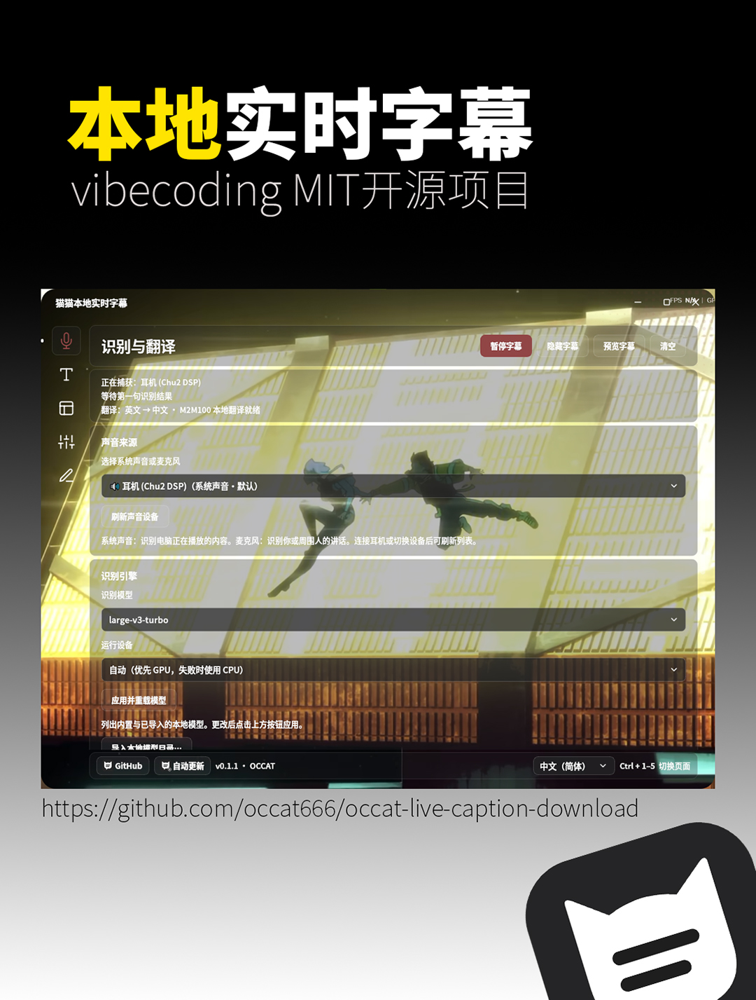

# 貓貓本地即時字幕 / Maomao Local Live Captions

[简体中文](README.md) · **繁體中文** · [English](README.en.md) · [日本語](README.ja.md) · [한국어](README.ko.md) · 作者 **OCCAT**

  

我是 **OCCAT**，這是我做的本機即時字幕工具，提供 Windows 版與 macOS 原生預覽版。你可以把電腦正在播放的聲音，或者麥克風裡的說話聲，顯示成浮動字幕；需要的時候，也可以把英文、日文、韓文翻譯成中文。看影片、聽課、玩遊戲、看直播，或者開個人會議時，都可以用它輔助閱讀。

## 0.1.14 更新

- 修正開啟、關閉或調整字幕描邊與陰影時，背景尺寸和位置變動的問題。
- 保留原文及譯文獨立樣式、兩句上下文與即時回應策略；行為與驗證以發行說明為準。

## 0.1.13 更新

- 保留最近約兩句話的上下文，依各自字型與螢幕寬度顯示；原文即時跟進，不再逐頁追播舊字幕。
- 前一句仍在保留範圍時，允許晚到的譯文補入，不倒退目前原文；譯文替換保留閱讀時間，減少一閃而過。具體範圍請見發行說明。

## 0.1.12 更新

- 減少即時字幕處理與顯示鏈路的等待，保留短句閱讀、原文與譯文獨立軌道，以及完整收到文字的記錄。
- 速度仍受模型與硬體限制，不保證零延遲、逐詞時間對齊或恢復背壓略過的音訊。

## 可以怎麼用

- 系統聲音和麥克風輸入；按辨識模型能力選擇中文、英文、日文、韓文或自動判斷，以浮動字幕顯示。
- 獨立的即時翻譯開關，可同時保留原文；辨識引擎、翻譯和模型管理集中在「辨識與翻譯」。
- 模型說明與推薦提示、官方和鏡像下載入口、一鍵下載、斷點續傳、檔案驗證及本地模型匯入。
- 字幕字型、字重、字級、顏色、描邊、陰影、位置與底襯可調；可以儲存外觀版本，按需要恢復。字幕字形可選簡體中文、繁體中文、日語（日本字形）、韓語（韓文字形）或保留原文；簡繁轉換僅影響中文，日語、韓語使用內建地區思源字型並保留來源文字，不會將內容翻譯成日語或韓語。
- 简体中文、繁體中文、English、日本語、한국어 五種頁面語言與安裝語言；介面語言、字幕字形、語音辨識語言分別儲存。
- 介面提供 HarmonyOS Sans、MiSans、思源黑體、思源宋體，按各自原生字重選擇；也支援本地 TTF、OTF、TTC 字型匯入。
- 黑夜、白天、跟隨系統和自訂主題；自訂背景與玻璃透明度、模糊、壓暗設定同步。預設導覽圖示跟隨文字色，按下或選取使用主題色。
- 五個 Feather 向量圖示入口、浮動名稱提示和單一滑動遊標；支援 Tab 鍵盤導覽、Ctrl+1～5 切頁及關閉頁面動效。
- 暫停、預覽、隱藏字幕、視窗穿透、待機、系統匣入口和軟體內公開版本更新檢查（含預覽版）；設定頁支援滑鼠滾輪和觸控板滾動。

這次改動與修正的具體內容放在 [0.1.14 發行說明](https://github.com/occat666/occat-live-caption-download/releases/tag/v0.1.14)。

## 0.1.11 更新

- 長句依標點和可讀長度拆成較短資訊，按閱讀時間逐段顯示。
- 識別原文與譯文各自推進並保留樣式；這是兩條文字軌道，不保證逐詞或逐句時間對齊。
- 新識別段取代舊段；清空、暫停、預覽和工作階段切換會清理舊輪播，避免舊句累積排隊。隱藏字幕仍繼續識別，恢復時顯示目前進度。
- 本機字幕記錄保留收到的完整識別與翻譯文字，畫面短句不改寫識別結果。

## 0.1.10 更新（歷史）

- 修正反相立體聲混音後抵銷，以及多聲道只有中央聲道人聲時被過度衰減的問題；降低持續低電平人聲的觸發門檻，同時保留短脈衝與底噪保護。
- 聲音來源清單分別處理輸入與輸出列舉失敗；舊裝置失效後依名稱與來源類型恢復，遇到歧義時提示重新選擇，避免誤錄同名麥克風。
- 忙碌時只保留最新待處理終句和臨時句，被取代的舊音訊會略過，以優先跟上目前播放；需要完整記錄時，請選用能跟上即時速度的模型。控制台區分裝置未傳回資料、收到聲音與正在辨識。
- 結合辨識信心分數與無語音機率，過濾低可信度的重複、套話結果，減少靜音或背景聲下的幻覺字幕，並保留有充分辨識證據的正常話語。
- 原文與譯文獨立樣式、中日韓字形、五種介面語言與首次下載 large-v3-turbo 繼續保留。速度與準確率仍取決於模型、內容和硬體，不保證零延遲或零幻覺。

- 移除通用中英文辨識提示語，修正純音被模型複述成提示語字幕的已重現問題；實際模型樣本已驗證修正結果。

## 0.1.9 更新（歷史）

- 辨識原文與翻譯字幕的格式獨立設定：字型、字級、字重、顏色、不透明度、描邊和陰影均可分別調整。
- 開啟「字幕外觀」，分別調整「辨識原文」和「翻譯字幕」；翻譯關閉時也能預覽譯文樣式。位置、背景、行距和最多行數共用。
- 舊設定會自動複製為譯文的初始樣式，此後兩組設定獨立儲存。支援五種介面語言，保留即時翻譯、中日韓字形和首次下載 large-v3-turbo。

## 0.1.6 更新（歷史）

- 軟體內檢查最新公開版本，包含預覽版，不再只依賴 GitHub 的 latest 正式版介面。下載安裝程式並確認後，已安裝版在目前安裝目錄覆蓋升級，保留既有設定、模型與語言選擇。
- 免安裝版先說明更新方式，再開啟一般安裝精靈；不會在背景覆蓋原免安裝目錄。**0.1.5 及更早版本需先從 Releases 手動安裝一次 0.1.6 或更新版，之後才能使用新版的軟體內更新。**
- 目前句子的翻譯完成後才開始計算自動隱藏時間；即時中間辨識結果的翻譯經過節流，並優先處理目前句子，減少字幕過早隱藏與舊譯文蓋過新句的情況。暫停、切換、清空與舊任務的狀態互相隔離。
- GitHub API 達到流量限制或連線失敗時，改用專案官方公開更新清單繼續檢查；安裝程式仍依精確檔案大小及 SHA-256 驗證。

## 下載與安裝

**[開啟 0.1.14 公開測試版](https://github.com/occat666/occat-live-caption-download/releases/tag/v0.1.14)**。這是 **prerelease 預發行版本**；[上一版 0.1.13](https://github.com/occat666/occat-live-caption-download/releases/tag/v0.1.13) 保留，方便回復舊版，其他舊版也保留在 Releases。

安裝版和免安裝版**選一個即可**，不用下載整個倉庫或所有 ZIP：

| 檔案 | 選擇方式 |
| --- | --- |
| [OCCAT-Live-Caption-0.1.14-windows-x64-setup.exe](https://github.com/occat666/occat-live-caption-download/releases/download/v0.1.14/OCCAT-Live-Caption-0.1.14-windows-x64-setup.exe) | 安裝版，統一提供简体中文 / 繁體中文 / English / 日本語 / 한국어 |
| [OCCAT-Live-Caption-0.1.14-windows-x64-portable.zip](https://github.com/occat666/occat-live-caption-download/releases/download/v0.1.14/OCCAT-Live-Caption-0.1.14-windows-x64-portable.zip) | 免安裝版，完整解壓縮後執行 `OCCATLiveCaption.exe` |
| [SHA256SUMS.txt](https://github.com/occat666/occat-live-caption-download/releases/download/v0.1.14/SHA256SUMS.txt) | 可選，用於核對本版 Windows 附件 |
| `CorrespondingSources-*.zip`、`Sources-Sherpa-ASR-*.zip`、`OCCAT-Live-Caption-0.1.14-Third-Party-Notices.zip` | 第三方對應原始碼與授權材料，一般使用時不必逐一下載 |

1. 使用 **Windows 10/11 x64**，並具備 Microsoft Visual C++ x64 執行階段程式庫 **14.44.35211 或更新版**。安裝器發現執行階段程式庫缺失或過舊時，會在確認後從微軟官方下載、驗證數位簽章並開啟安裝介面。請按提示確認微軟授權及管理員授權，完成後自動繼續字幕安裝；需要連線至網路，不會自動重新啟動。微軟提示必須重新啟動時，請儲存工作、自行重新啟動，再執行字幕安裝器。免安裝版同樣需要先具備執行階段程式庫。
2. 安裝版按兩下 EXE，選擇簡體中文、繁體中文、英文、日文或韓文並依精靈完成安裝；免安裝版請完整解壓縮後啟動，不要單獨取出 EXE。安裝套件沒有商業程式碼簽章，請核對下載來源與 SHA-256。
3. 啟動「貓貓本地即時字幕」，選擇實際播放聲音的系統裝置或麥克風。新使用者預設使用 **Whisper large-v3-turbo**，首次使用需連線下載約 **1.6 GB** 並完成驗證；下載支援續傳和來源切換，完整快取後優先從本機載入，可離線使用。其他 8 個辨識模型按需下載，也可匯入相容的本地模型；升級不覆蓋已有模型選擇。
4. 需要翻譯時，在「辨識與翻譯」下載或匯入相容的 **M2M100** 模型，再開啟「即時翻譯」；只看原文時保持關閉。
5. 在「字幕外觀」調整字幕樣式，在「視窗與待機」調整位置、穿透和待機方式。底部語言選單支援简体中文、繁體中文、English、日本語、한국어，辨識語言單獨設定。中日韓字幕字形在「字幕外觀 → 辨識原文 · 文字」設定，不隨介面語言切換。

本版的軟體版本號為 **0.1.14**，發行標籤為 **`v0.1.14`**，仍按預發行版本提供。**本版的軟體內更新支援公開預覽版。0.1.5 及更早版本仍只查詢舊的 latest 介面，需先手動安裝一次 0.1.6 或更新版；之後可在軟體內檢查並更新。** 舊分語言安裝套件使用者可手動升級到上面的統一安裝套件；繁體中文、日文、韓文安裝精靈保留已審閱的英文元件條款原文。

按使用者安裝，已有設定優先。安裝版和免安裝版均把設定、下載模型和字幕記錄儲存到 `%LOCALAPPDATA%/OCCATLiveCaption`，解除安裝保留使用者資料；免安裝版不會把設定放在解壓縮目錄裡。

**從舊版升級：** 已有模型選擇與其他設定會保留。如果升級後仍顯示 Base，請到「辨識與翻譯 → 辨識引擎 → 辨識模型」選擇 `large-v3-turbo`，再點擊重新載入按鈕（介面顯示「應用並過載模型」），即可下載並使用 Turbo；新使用者預設選擇 Turbo。

## macOS 預覽版下載

0.1.14本輪十一組共267項回歸通過，其中35項背景及文字特效檢查；Windows五語安裝/啟動/移除及0.1.13→0.1.14覆蓋升級、Mac兩架構原生建置與獨立核驗通過。實體收音硬體、乾淨系統及長期執行仍須實測。

**需要 macOS 14 或更新版本。** 依處理器選擇一個 DMG：

| Mac 類型 | 下載 |
| --- | --- |
| Apple 晶片（M1 及更新機型） | [OCCATLiveCaption-0.1.14-macOS-arm64.dmg](https://github.com/occat666/occat-live-caption-download/releases/download/v0.1.14/OCCATLiveCaption-0.1.14-macOS-arm64.dmg) |
| Intel | [OCCATLiveCaption-0.1.14-macOS-x86_64.dmg](https://github.com/occat666/occat-live-caption-download/releases/download/v0.1.14/OCCATLiveCaption-0.1.14-macOS-x86_64.dmg) |

開啟 DMG，將應用程式拖到「應用程式」資料夾。此預覽套件採用 **ad-hoc 簽章，未經 Apple 公證**；首次嘗試開啟後，macOS 可能要求在「系統設定 → 隱私權與安全性」針對此應用程式選擇「強制打開」。請使用同版 Release 的 [SHA256SUMS-macOS.txt](https://github.com/occat666/occat-live-caption-download/releases/download/v0.1.14/SHA256SUMS-macOS.txt) 核對 Mac 附件。Mac 版的更新入口會開啟 Releases 下載頁；下載新 DMG 並替換應用程式，設定、模型與字幕記錄保存在 `~/Library/Application Support/OCCATLiveCaption`。

Mac 版使用 **CPU 推論**，新使用者仍預設在首次使用時下載 **large-v3-turbo（約 1.6 GB）**，不內建模型，也不會自動改選 Base；其他模型按需下載。大型模型的 CPU 速度取決於硬體，預覽套件不保證即時效能。

音訊來源採用 CoreAudio 輸入，開始擷取時需要允許麥克風權限。播放中的系統聲音需要自行安裝並設定 **BlackHole 等虛擬輸入**，軟體不隨附或安裝音訊驅動程式。步驟見 [macOS 聲音來源設定（簡體中文）](docs/macos-audio.md)。

0.1.14本輪十一組共267項回歸通過，其中35項背景及文字特效檢查；Windows五語安裝/啟動/移除及0.1.13→0.1.14覆蓋升級、Mac兩架構原生建置與獨立核驗通過。實體收音硬體、乾淨系統及長期執行仍須實測。

Mac 預覽套件內建思源黑體、思源宋體及日語／韓語地區思源字型，其他字型可從本機匯入。

## 自訂主題範例

這是使用者提供的自訂主題截圖預覽。在「頁面外觀」選擇「自訂」後，可以自行設定背景圖片；原始桌布不隨安裝套件分發。

## 驗證範圍與使用說明

0.1.14本輪十一組共267項回歸通過，其中35項背景及文字特效檢查；Windows五語安裝/啟動/移除及0.1.13→0.1.14覆蓋升級、Mac兩架構原生建置與獨立核驗通過。實體收音硬體、乾淨系統及長期執行仍須實測。

**尚未在缺少執行階段程式庫的乾淨 Windows 環境實測，仍屬於預發行版本。** 我沒有把這些檢查當作所有 GPU、多螢幕、音訊裝置和系統組合的保證。

辨識和翻譯在本機執行；首次辨識模型下載、按需翻譯模型下載和更新檢查會連線至網路，模型完整快取後可在本機離線使用。**預設儲存本地字幕文字**，可在進階設定關閉，關閉不會刪除舊記錄。個人背景圖片、自行匯入的模型和字型不隨官方安裝套件釋出。

字幕和翻譯可能有誤，重要內容請人工核對；這是輔助閱讀工具，不替代專業無障礙服務或正式記錄。請只處理有權使用的內容，採集他人發言前取得必要授權。

## 授權與公開範圍

本下載倉庫文件及我自己的程式碼採用 [MIT](LICENSE)，署名 **OCCAT**。**應用開發原始碼倉庫保持 Private；這個公共倉庫提供軟體下載與分發材料，不表示全部應用原始碼已經公開。**

安裝套件並非整套 MIT。導覽與視窗控制元件使用 [Feather v4.29.0 官方圖示](https://github.com/feathericons/feather/tree/v4.29.0)，其 [MIT 原始授權](https://github.com/feathericons/feather/blob/v4.29.0/LICENSE) 隨安裝套件和同版通知歸檔提供。四種介面字型、Whisper 模型（按需下載）、Qt、FFmpeg/PyAV、Sherpa ASR、Intel/NVIDIA 等保留各自適用的授權和元件條款；字型的原始授權也隨本版通知歸檔提供。 新增的日語、韓語地區思源黑體保持 Adobe 官方原版，採用 SIL Open Font License 1.1，原始授權隨同版材料提供。

同版 Release 附第三方對應原始碼、建置材料、原始版權通知和校驗清單。入口見[第三方授權說明](THIRD_PARTY_NOTICE_PUBLIC.md)與[共用程式庫修改/替換指引](LIBRARY_REPLACEMENT.zh-CN.md)；適用的 LGPL 修改、替換及必要偵錯權利保持不變。公開附件不包含自有應用 Source.zip、建置報告或使用者資料。

歡迎在 [Issues](https://github.com/occat666/occat-live-caption-download/issues) 回報問題，附候選版本、系統、模型和重現步驟，提交前請刪除私人目錄、帳號、錄音與真實對話內容。
